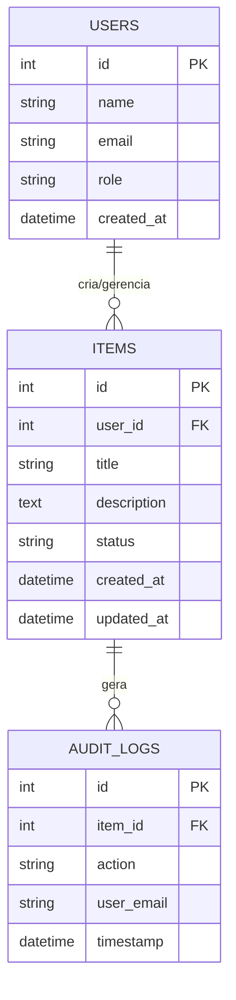

# DB_SCHEMA — Modelagem do Banco de Dados: Portfólio Profissional (Analista de IA)

- **Engine Recomendada:** SQLite (Local/Dev) / PostgreSQL (Produção)
- **Data:** 2026-11-07T06:45:03.748Z

---

## 1. Diagrama ER (Mermaid)



---

## 2. DDL SQL (Schema Inicial)

```sql
CREATE TABLE IF NOT EXISTS users (
    id INTEGER PRIMARY KEY AUTOINCREMENT,
    name VARCHAR(150) NOT NULL,
    email VARCHAR(200) UNIQUE NOT NULL,
    role VARCHAR(50) DEFAULT 'user',
    created_at TIMESTAMP DEFAULT CURRENT_TIMESTAMP
);

CREATE TABLE IF NOT EXISTS items (
    id INTEGER PRIMARY KEY AUTOINCREMENT,
    user_id INTEGER,
    title VARCHAR(255) NOT NULL,
    description TEXT,
    status VARCHAR(50) DEFAULT 'active',
    created_at TIMESTAMP DEFAULT CURRENT_TIMESTAMP,
    updated_at TIMESTAMP DEFAULT CURRENT_TIMESTAMP,
    FOREIGN KEY (user_id) REFERENCES users(id)
);

CREATE TABLE IF NOT EXISTS audit_logs (
    id INTEGER PRIMARY KEY AUTOINCREMENT,
    item_id INTEGER,
    action VARCHAR(100) NOT NULL,
    user_email VARCHAR(200),
    timestamp TIMESTAMP DEFAULT CURRENT_TIMESTAMP,
    FOREIGN KEY (item_id) REFERENCES items(id)
);

CREATE INDEX IF NOT EXISTS idx_items_status ON items(status);
CREATE INDEX IF NOT EXISTS idx_items_created ON items(created_at);
```
