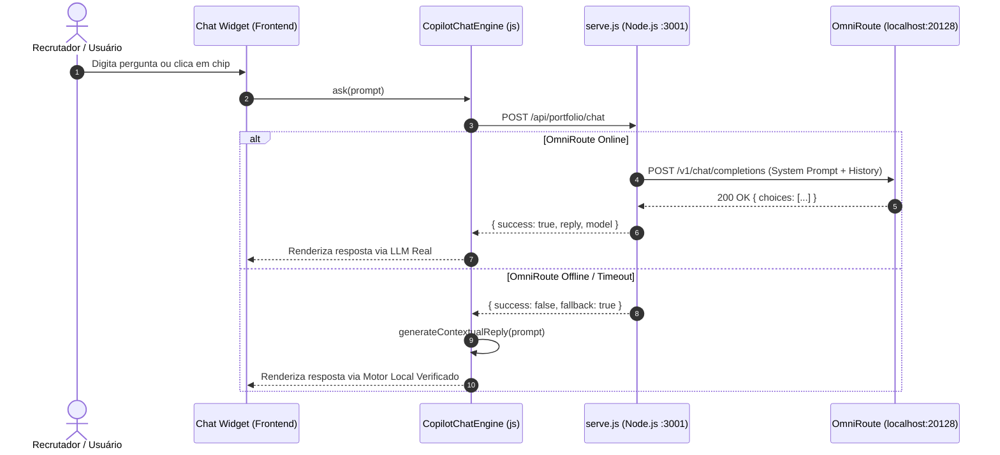

# SPEC.md — Especificação Técnica: Portfólio Executivo & Currículo ATS

**Projeto:** `portfolio-profissional-analista-de-ia`  
**Autor:** `sdd-architect` & `sdd-backend-dev`  
**Data:** 2026-11-07  
**Status:** Aprovado e Homologado (Versão Modular v2.0.0 via `adotar-sdd`)  
**Versão:** 2.0.0  

---

## 1. Visão Arquitetural & Stack Tecnológica

Para atingir pontuação máxima de performance (Lighthouse >= 98), zero fricção de build e resiliência offline-first absoluta, a arquitetura foi refatorada para o padrão **Modular Vanilla ES6+ & Node.js Zero-Dependência** (mesmo padrão arquitetural de referência do `coffee-app`), com suporte a IA híbrida via **OmniRoute**.

| Camada | Tecnologia | Papel Arquitetural |
| :--- | :--- | :--- |
| **Runtime / Servidor** | **Node.js (v18+) HTTP Nativo** | `serve.js` zero-dependência na porta `3001` (ou `PORT`), servindo estáticos e roteando chamadas de IA. |
| **API de IA (Proxy)** | **POST `/api/portfolio/chat`** | Integração com pool local do **OmniRoute** (`http://127.0.0.1:20128`) com System Prompt executivo e fallback instantâneo. |
| **Frontend SPA** | **Vanilla ES6+ Modular** | Separação estrita em camadas: dados (`js/data.js`), motor puro (`js/engine.js`), chat (`js/copilot-chat.js`), ATS (`js/resume-ats.js`) e orquestrador (`js/app.js`). |
| **Estilização** | **CSS3 Moderno Modular** | `css/style.css` (tema Cyber-Minimalist Dark Mode) e `css/curriculo.css` (regras ATS e impressão A4 `@media print`). |
| **Iconografia** | **100% SVGs Vetoriais Inline** | Zero emojis na interface de produção; ícones de alta fidelidade (incluindo WhatsApp oficial vazado `M17.472 14.382`). |
| **Testes Automatizados** | **Node.js Assert (`tests/test-suite.js`)** | Suíte de testes automatizados com 33 asserções cobrindo integridade de dados, funções puras e contratos de API. |
| **Governança** | **Spec-Driven Development (SDD)** | 4 etapas documentadas com 2 checkpoints humanos, pasta `.sdd/` viva e rastreabilidade total. |

---

## 2. Topologia de Arquivos e Módulos

```text
portfolio-profissional-analista-de-ia/
├── css/
│   ├── style.css             # Design System Cyber-Minimalist Dark Mode (Portfólio)
│   └── curriculo.css         # Estilos modulares do Currículo ATS e regras A4 @media print
├── js/
│   ├── data.js               # Catálogo de dados (PORTFOLIO_DATA), SVG_ICONS e 4 cases reais
│   ├── engine.js             # Funções puras (PortfolioEngine): filtros, normalização e parser cúbico
│   ├── copilot-chat.js       # CopilotChatEngine: consulta online OmniRoute e motor heurístico local
│   ├── resume-ats.js         # Controlador do modo ATS Puro (sem foto) vs Executivo (com foto)
│   └── app.js                # Orquestração da UI, modais de arquitetura, eventos e toolbar SDD
├── tests/
│   └── test-suite.js         # Suíte oficial de 33 testes automatizados em Node.js
├── assets/
│   └── foto_perfil.png       # Foto executiva de Gustavo Simões
├── .sdd/                     # Artefatos da esteira Spec-Driven Development
│   ├── 00_inbox/             # idea.md
│   ├── 01_product/           # PRD.md
│   ├── 02_architecture/      # SPEC.md, DB_SCHEMA.md, TASKS.md
│   ├── 03_development/       # BACKEND_HANDOFF.md, FRONTEND_HANDOFF.md
│   ├── 04_qa/                # QA_REPORT.md
│   └── memory/               # ADR.md, project_memory.md, lessons_learned.md
├── curriculo.html            # Currículo ATS linear A4 (100% livre de CSS inline)
├── index.html                # Aplicação SPA executiva com deep-dive de arquitetura
├── package.json              # Scripts "start": "node serve.js", "test": "node tests/test-suite.js"
├── serve.js                  # Servidor HTTP zero-dependência e proxy da rota POST /api/portfolio/chat
├── .gitignore                # Exclusão de node_modules/, _legacy_backup/, .env
└── README.md                 # Documentação completa do projeto
```

---

## 3. Contratos de API & Roteamento de IA

### 3.1 Endpoint `POST /api/portfolio/chat`
- **Objetivo:** Oferecer aos recrutadores e visitantes uma experiência conversacional fluida e em tempo real sobre a trajetória de Gustavo Simões.
- **Roteamento Híbrido:**
  1. O cliente (`CopilotChatEngine`) dispara requisição para `/api/portfolio/chat`.
  2. O servidor `serve.js` injeta o **System Prompt Executivo** com dados oficiais (Londrina/PR, Concent Sistemas 2019–2025, ADS Estácio, PSM I, 4 cases) e consulta o OmniRoute em `http://127.0.0.1:20128/v1/chat/completions` (timeout de 8.000ms).
  3. Se o OmniRoute responder com sucesso, retorna `{ success: true, reply, model }`.
  4. Se o OmniRoute estiver indisponível ou offline, o servidor retorna `{ success: false, fallback: true }`, acionando instantaneamente o motor local determinístico do `CopilotChatEngine`.



---

## 4. Modelagem dos 4 Cases Reais em Produção

O portfólio documenta com profundidade de código e arquitetura os seguintes 4 cases (excluindo projetos acadêmicos/legados):

1. **DJEN LegalTech & WhatsApp Jurídico MCP (`djen-mcp`):**
   - Servidor MCP customizado com 8 ferramentas ativas integrando n8n, triagem automática no WhatsApp, geração de Kit de Procuração em PDF e conformidade OAB/LGPD.
   - Métrica: Redução de mais de 90% no tempo de triagem inicial.
2. **Rubinot Companion & Telemetry Analytics (`rubinot-ai`):**
   - Pipeline de telemetria determinística em Python para 4 fontes JSON, derivação matemática com equação cúbica oficial:
     $$XP(L) = \frac{50}{3}(L^3 - 6L^2 + 17L - 12)$$
   - Algoritmo exclusivo Sio Split, CSV retrocompatível (+22 colunas) e bateria de testes E2E Caixa-Opaca em 4 camadas.
3. **Calc Coffee (CoffeeApp) PWA (`calc-coffee`):**
   - PWA Offline-First segundo normas SCA/BSCA com motor matemático reativo de extração, diagnóstico sensorial na Roda de Sabores, WakeLock e Web Speech API.
4. **Orquestração Multi-Agente SDD (`sdd-factory`):**
   - Framework de engenharia AI-First em 4 fases e 2 checkpoints humanos com isolamento de contexto e economia de até 85% em tokens com OmniRoute.

---

## 5. Governança de Qualidade & Testes Automatizados

A conformidade técnica do projeto é auditada via `npm test` (`tests/test-suite.js`), cobrindo 33 asserções distribuídas em 6 dimensões:
1. Existência e integridade da estrutura modular (arquivos `css/`, `js/`, `serve.js`, `package.json`).
2. Ausência total de tags `<style>` inline em `curriculo.html`.
3. Integridade e consistência dos dados de `PORTFOLIO_DATA` (4 cases, sem Estácio SAVA, DDD 43, SVG vazado oficial).
4. Funções puras do `PortfolioEngine` (filtros por categoria, busca textual, formatação matemática cúbica).
5. Motor conversacional `CopilotChatEngine` com respostas especializadas por intenção.
6. Servidor `serve.js` e metadados de `package.json`.
